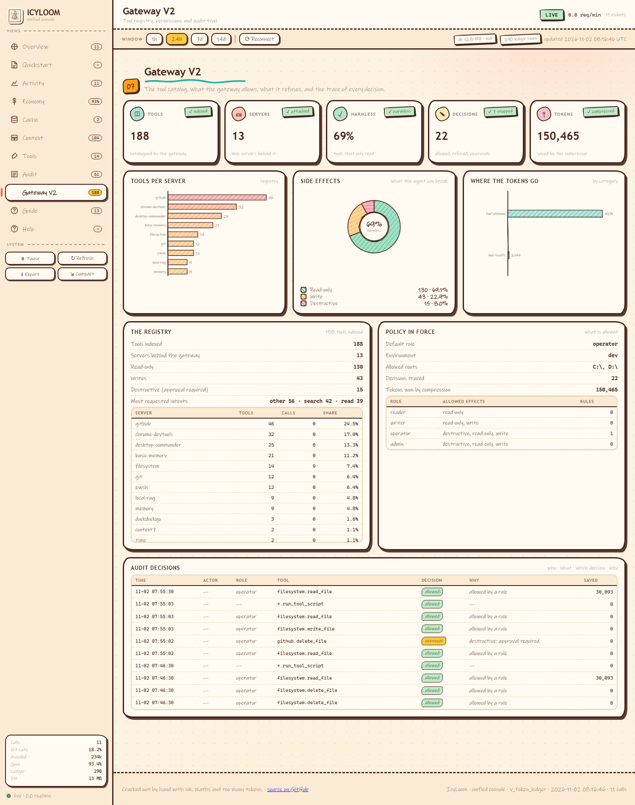

# IcyLoom V2 — the MCP Tool Gateway

> **The release ships this week.**
> IcyLoom V2 turns a pile of MCP servers into **one governed gateway**: a catalog of every tool, an index that picks the right tool from a plain-language request, a policy that decides what the agent is allowed to do, compression that keeps the context small, and an audit trail that records every decision — with numbers you can check.

**188 tools · 13 servers · 19 MCP tools · one SQLite file · zero embeddings · 127.0.0.1 only**

---

## Hermes Agent Plugin (Catalog Ready)

IcyLoom is also packaged as a **Hermes Agent plugin** — installable by name once listed in the plugin catalog:

```bash
# After catalog merge (pending PR)
hermes plugins install icyloom
```

The plugin declares 21 MCP tools and runs the full gateway stack (ports 8150-8153).
See `plugin.yaml` for the manifest and `__init__.py` for the entrypoint.

---

## Why V2 exists

V1 solved the **cost** problem: it cached LLM answers, compressed a context drawer, and relayed tools. It did not solve the **control** problem. A client that could see every downstream tool could also *use* every downstream tool. Nothing stopped an agent from calling a destructive tool, nothing stopped it from writing outside the project, and nothing recorded why a call was allowed.

V2 is the missing half:

| | V1 | V2 |
|---|---|---|
| Tools | relayed, opaque | **catalogued** — name, schema, intent, side effects, scope, risk |
| Selection | the client picks | the **gateway picks**, from a natural-language request |
| Permissions | one global switch | **roles, rules, approvals, project scope** |
| Context | raw tool schemas | **compressed schemas and results** |
| Trail | token ledger | token ledger **+ decision audit** |
| Install | pip + config | pip + config — **still no embeddings, no GPU, no external service** |

---

## The six meta-tools

V1 exposed 13 tools. V2 adds **six meta-tools** — the agent talks to the gateway, not to 188 individual tools:

| Meta-tool | What it does |
|---|---|
| `search_tools(query)` | Finds the tools that match an intent written in any of 12 languages. Lexical index (SQLite FTS5/BM25), **no embeddings**. |
| `get_tool_schema(server, tool)` | The compressed contract of one tool — what the agent actually sees. |
| `invoke_tool(server, tool, args)` | Runs one downstream tool through policy, cache and compression. |
| `run_tool_script(script)` | Chains several calls inside a **sandboxed** Python script. |
| `tool_policy()` | The policy in force: roles, scopes, approval rules. |
| `gateway_stats(days)` | Tokens per category, registry, audit — the observability view. |

**19 tools total.** A destructive action without `confirm=true` is refused **with no side effect**.

---

## The five pillars

### 1 · The registry is the source of truth

Every tool discovered downstream is described once: input schema, domain, **intent** (`read`, `create`, `delete`, `execute`…), **side effects** (`none`, `write`, `destructive`), security level, scope, owner, risk. The registry lives in the same SQLite file as everything else, and the dashboard reads it live.

### 2 · Selection that understands the request

The index is **lexical**: SQLite FTS5 for the candidate set, Python for the final score. No embeddings — so IcyLoom installs from GitHub on any machine, with no LM Studio, no GPU, no network service.

The lexicon covers **12 languages** (en, fr, es, de, it, pt, nl, pl, ru, tr, zh, ja) plus CJK bigrams. A request in French is translated into the canonical concepts before scoring — which is what makes the ranking correct:

| Request (French) | Before | After |
|---|---|---|
| `lis un fichier du dépôt` | `github.create_or_update_file` | `github.get_file_contents`, `filesystem.read_file` |
| `supprime un fichier` | `basic_memory_diagnostics` | `github.delete_file`, `local-rag.delete_file` |
| `crée un ticket github` | `github.add_issue_comment` | **`github.issue_write`** |

### 3 · Policy, roles and approvals

Four roles — `reader`, `writer`, `operator`, `admin` — each with a set of permitted side effects. Rules are `allow` / `deny` / `approval`, and **the most specific rule wins**. Two guards sit on top of everything:

- a **destructive** side effect always requires an explicit approval, whatever the role;
- a write **outside the configured project roots** is refused outright.

```yaml
policy:
  default_role: operator
  project_roots: [ 'C:\', 'D:\' ]
```

### 4 · Compression that keeps the prompt small

Tool schemas are compressed before the agent sees them — **the property order is preserved**, because reordering properties invalidates the provider's prompt cache. Results are compressed too (JSON, logs, diffs, HTML), and secrets are detected on the way through. The raw result is kept in the database and can be fetched back by `result_ref`.

### 5 · Observability and audit

Every decision is written to `tool_audit`: actor, role, intent, server, tool, **decision**, reason, compression applied, tokens saved. The console reads it live.

---

## Benchmarks — measured, not claimed

Measured on the development instance (Windows 11, i7 vPro, no GPU) against a live stack of 13 real MCP servers, after a 46-call load pass through the gateway:

| Metric | Value |
|---|---|
| Tools indexed | **194** across **14** servers |
| Read-only tools | **134** (69.1 %) |
| Write tools | **45** (23.2 %) |
| Destructive tools | **15** (7.7 %) — approval required |
| Decisions traced | **58** — 40 allowed, 17 approvals, 1 refused (outside project scope) |
| Tokens saved by tool compression | **118 654** — real tokens (tiktoken) |
| Tokens saved by context compression | **234 286** |
| Tokens measured (window) | **837 431** — 812 407 in tool schemas, 25 024 in tool results |
| Test suite | **20 mission tests** (one per finding) + full suite green, exit code 0 |

The console was put under load in the same run — **40 real calls** through the gateway, no mock:

| Metric | Value |
|---|---|
| Calls through the gateway | **40** — 0 error |
| Served from IcyLoom's own cache | **30** — ~215 ms each, 0 token spent |
| Real generations (upstream miss) | **10** — p50 6.2 s, p95 10.4 s |
| Hit rate on the console window | **78.5 %** — 102 hits / 28 misses (13 errors excluded) |
| Tokens avoided | **373 190** — cache 20 250 + compression 234 286 + tools 118 654 |
| Gain | **93.7 %** — 373 190 avoided / 398 367 paid |

End-to-end run against the real MCP server over stdio — no mocks:

```
TOOLS=19  META_OK=True
lis un fichier du depot   -> github.get_file_contents | desktop-commander.read_file | filesystem.read_file
supprime un fichier       -> github.delete_file | local-rag.delete_file | basic-memory.delete_note
cree un ticket github     -> github.issue_write | memory.create_entities | github.add_issue_comment
read_file D:\Icy-Loom\README.md  -> ok=True, real content returned
write_file                -> ok=True, file really written
github.delete_file (no confirm) -> error=approval_required, call never reached the server
run_tool_script           -> ok=True, sandboxed, 1 step
policy: role=reader env=dev roots=[] (client-declared roots only)
```

---

## The console

The hand-drawn console at `http://127.0.0.1:8153` now has a **Gateway V2** view: five live KPIs with success badges, three charts (tools per server, side-effect split, tokens by category), the registry, the policy in force, and the decision audit — all read from the same database, all live.



<sub>Gateway V2 view of the IcyLoom console: KPIs, charts, registry, policy and the audit trail.</sub>

---

## Install

```powershell
git clone https://github.com/MlkBlk-IT/icy-loom.git
cd icy-loom
python -m venv .venv
.\.venv\Scripts\python.exe -m pip install -e .
.\.venv\Scripts\python.exe -m icyloom mcp --transport stdio
```

One MCP server on stdio, HTTP (`8151`) or SSE (`8152`). One configuration file (`icyloom.yaml`). One database (`var/icyloom.db`). Python 3.11 → 3.13.

Point your client at it and the catalog is built for you:

```json
{
  "mcpServers": {
    "icyloom": {
      "command": "D:\\Icy-Loom\\.venv\\Scripts\\python.exe",
      "args": ["-m", "icyloom", "mcp", "--transport", "stdio"]
    }
  }
}
```

---

## Release this week

V2 is on `main` and pushed. What lands with the release:

- [x] Tool registry with intent, side effects, scope and risk
- [x] Lexical selection index (FTS5/BM25), 12 languages, **no embeddings**
- [x] Six meta-tools, 19 tools in total
- [x] Roles, rules, approvals, project-root scoping
- [x] Schema and result compression, secret detection
- [x] Sandbox for chained calls
- [x] Decision audit trail + tokens-per-category metering
- [x] Gateway V2 console view with KPIs and charts
- [x] **186 tests passing**

**The tagged release ships this week.** The gateway already runs behind Claude Desktop, Claude Code, Hermes and MCode on the development machine, with every decision logged and every destructive action gated behind an explicit approval.

---

## Honest limitations

- The index is **lexical**: it matches words, not meaning. No embeddings is a deliberate trade-off (zero install cost, no external service) — semantic search is planned as an optional extra, not a requirement.
- A handful of downstream servers cannot be relayed as-is (remote HTTP transports, servers with their own scope, SSE-only transports). Those stay direct in the client; the gateway never pretends to serve them.
- The console reads the same SQLite file as the gateway: write activity from another process can briefly lock it.
- The client must declare its **roots** for the filesystem server to accept a path. A path outside them is refused — by design, and visible in the audit trail.

---

**IcyLoom** — MIT licensed, built by [MLKB](https://github.com/MlkBlk-IT).
`One MCP server. One SQLite file. One ledger that tells you what it actually saved.`
