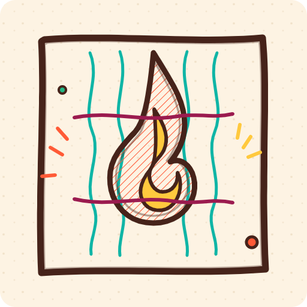
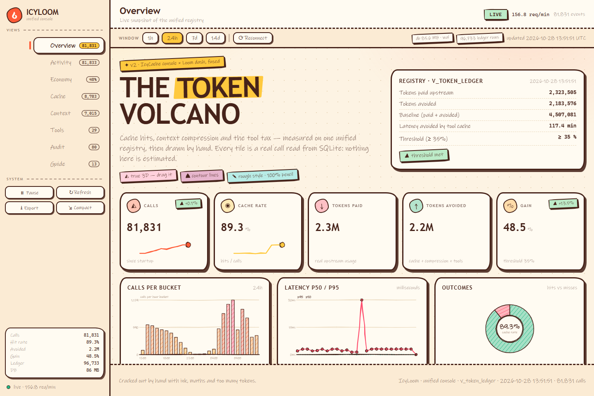
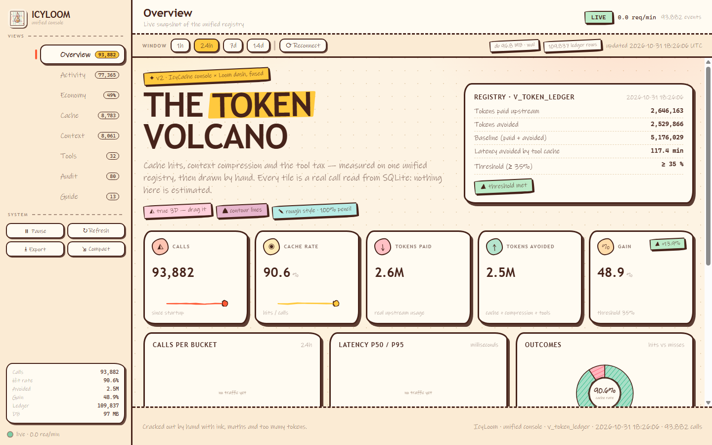
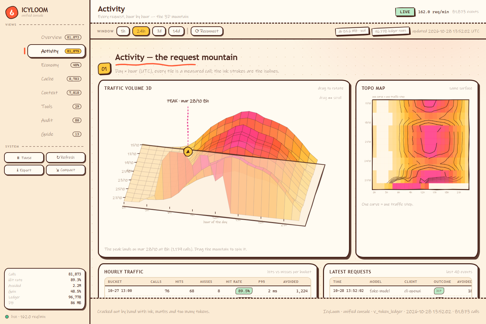
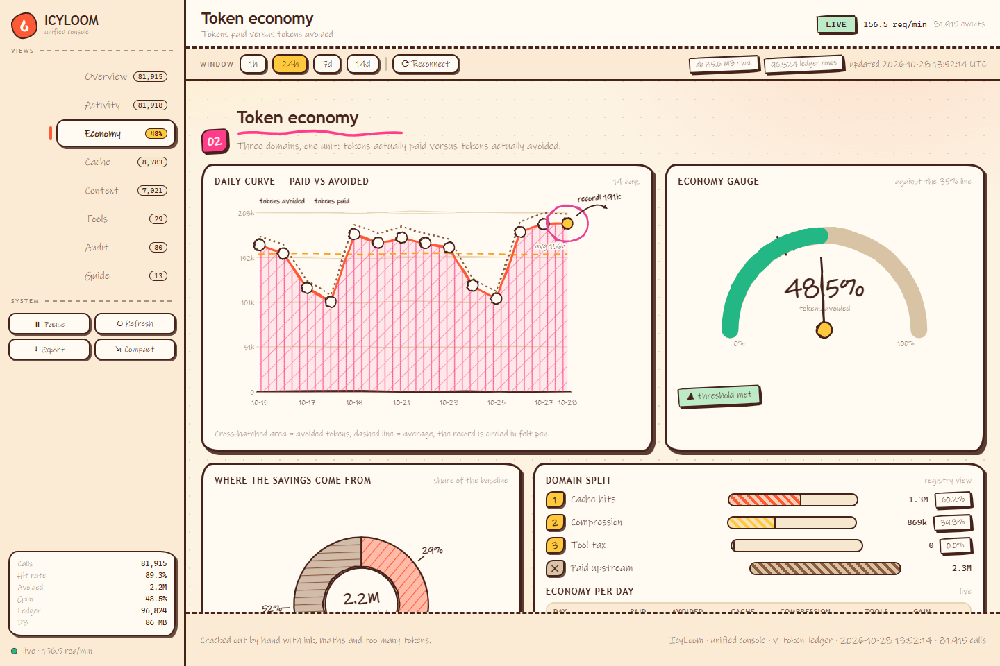
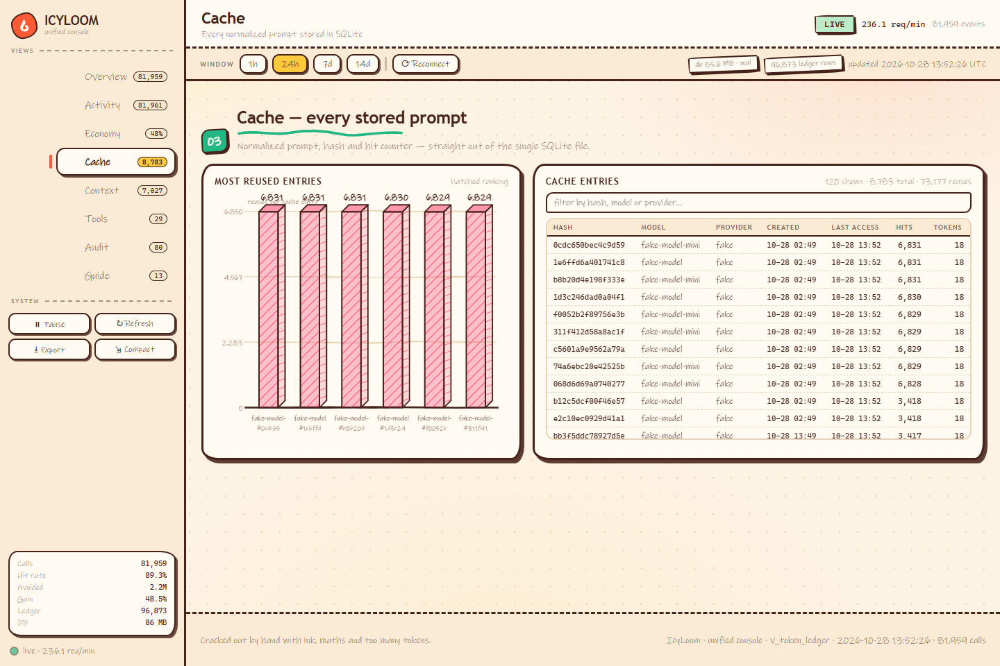
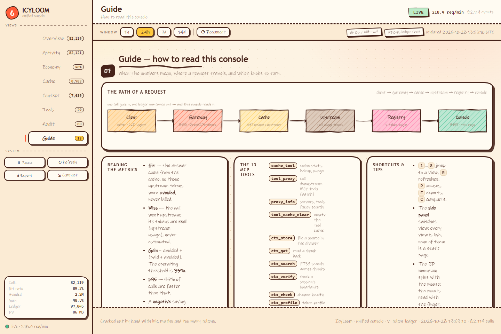

<div align="center">



# IcyLoom

**One MCP server. One SQLite file. One ledger that tells you what it actually saved.**

[](https://www.python.org/)
[](LICENSE)
[](src/icyloom/mcpserver.py)
[](tests/)
[](icyloom.yaml)

</div>

---

A local gateway that puts an **LLM cache**, a **compressed context drawer** and an **MCP tool relay** behind **one MCP server**, **one configuration file** and **one SQLite database**.

IcyLoom is a **standalone** project: no imports, links or paths to any other project. The code is written from scratch; the only files taken from elsewhere are **data** (normalisation rules, a tool registry), because the cache hash depends on them.

| | |
|---|---|
| **Cache** | Every prompt normalised, hashed and stored. A hit is a **zero-token** answer. |
| **Context drawer** | Sources filed, chunked, anchored, invariants checked — compressed on demand, opt-in. |
| **Tool relay** | Downstream MCP servers, cached by canonical signature, **deny by default**. |
| **Registry** | `v_token_ledger`: tokens **paid upstream** and tokens **avoided**, in one unit, one view. |
| **Console** | A hand-drawn web console on `:8153` — side panel, live views, working buttons. |
| **Privacy** | Binds `127.0.0.1`. Nothing leaves the machine. |

**The numbers are real.** A cache hit is counted as *avoided*, a miss is counted as *paid* with the upstream's own usage figures — never estimated. The 35 % threshold is read straight from the ledger.



<sub>Overview: the unified registry, five live KPIs, calls per bucket, latency, outcomes, models, upstreams. Captured on a demo database seeded by `tools/seed_demo.py` (synthetic traffic) — not production data.</sub>

## Quick start

Five minutes, on a clean machine. No GPU, no paid API, no LM Studio, no Node,
no `uvx`.

### Linux / macOS

```bash
python3 -m venv venv
source venv/bin/activate
python -m pip install --upgrade pip
python -m pip install https://github.com/MlkBlk-IT/icy-loom/releases/download/v1.0.0/icyloom-1.0.0-py3-none-any.whl

icyloom init
icyloom doctor

# in a second terminal
icyloom serve
icyloom check --transport all
```

### Windows (PowerShell)

```powershell
py -3.12 -m venv venv
.\venv\Scripts\Activate.ps1
python -m pip install --upgrade pip
python -m pip install https://github.com/MlkBlk-IT/icy-loom/releases/download/v1.0.0/icyloom-1.0.0-py3-none-any.whl

icyloom init
icyloom doctor

# in a second terminal
icyloom serve
icyloom check --transport all
```

Without the wheel (git required):

```bash
python -m pip install "icyloom @ git+https://github.com/MlkBlk-IT/icy-loom.git@v1.0.0"
```

Expected output of `icyloom check`: `21/21 vérifications réussies`.

`icyloom check` plays the role of the client: it starts the server, connects,
lists the 13 tools and calls them (`ctx_store`, `ctx_search`, `ctx_verify`,
`cache`, `ledger`, `proxy_info`). It tests the **three** transports (stdio,
streamable-HTTP, SSE) and prints `21/21 vérifications réussies` when all is
well. If HTTP or SSE fails, the stack is not running (`icyloom serve`); the
**stdio** mode, on the other hand, is self-contained — it is the one Claude
Code and Cursor use.

Then plug IcyLoom into your MCP client:

```bash
icyloom client --target cursor --install     # writes the config on your machine
icyloom client --target claude               # prints the block to paste
```

Targets: `cursor`, `claude` (Desktop), `claude-code`, `windsurf`, `codex`,
`json` (raw block).

```
icyloom.yaml      single configuration (Pydantic)
src/icyloom/data/ externalised data, shipped inside the package (JSON)
var/icyloom.db    single SQLite database (WAL)

  HTTP gateway :8150                      MCP server (one build function)
    /v1/chat/completions                    stdio             dedicated process
    /v1/messages                            streamable-HTTP   :8151
    /v1/models, /v1/embeddings              SSE               :8152
    /{upstream}/v1/...                      13 tools, one surface
    cache -> routing -> upstream

  admin API + dashboard :8153
  gateway, MCP and admin all write to one database and one ledger
```

Outside a repository checkout, nothing is written inside `site-packages`: the
configuration, the database and the logs go to the user data directory —
`%LOCALAPPDATA%\icyloom` on Windows, `$XDG_DATA_HOME/icyloom` (or
`~/.local/share/icyloom`) on Linux and macOS. Override it with
`ICYLOOM_DATA_DIR`.

## Status & known limitations

This section is the honest summary. Raw measurements live in
[`docs/archive/PROGRESS.md`](docs/archive/PROGRESS.md).

| Area | Status |
|---|---|
| Installation from a wheel on a clean machine | **Verified.** `init`, `doctor` (exit 0), `serve`, `check` 21/21, from a venv outside the repository |
| Test suite | **137** tests pass (131 + 6 new proofs and regressions) |
| Cache round trip (miss then hit) | **Verified by an automated test**: the first request calls the upstream, the identical second request does not, the served response is identical, and the ledger records both |
| Tool relay | **Verified by an automated test** against a real MCP stdio server: the tool is reached, it answers, and the second identical call is served from the cache |
| Tool-result cache correctness (stale hits, replayed writes, cached errors, loop detection) | **Verified.** Synthetic harness: 0 stale hits out of 140 (before the fix: 425 out of 436). Real `fetch` server: 8 of 8 checks pass |
| Gateway latency | p50 13.5 ms (MISS) and 10.7 ms (HIT); p95 about 16 ms against a 200 ms budget |
| Latency gain on a slow tool | One real `fetch` call: 1527 ms first, 24 ms when repeated (one static page) |
| **Token savings on tool calls** | **Not delivered and not measured.** A tool-cache hit is ledgered with 0 tokens saved |
| Context compression | **Opt-in, off by default.** `ctx_verify` proves the invariants survive a round trip, but **answer quality is not proven** (see Known limitations) |
| Python versions | 3.11, 3.12, 3.13 supported. 3.14 is probed in CI but is **not** in the supported range yet |

The "50 percent tokens saved" printed by `tests/proof_e2e.py` is true by construction: that test sends every request twice. It is not a traffic figure and must not be quoted as one.

## Getting started

```bash
icyloom doctor        # diagnostics
icyloom serve         # gateway + MCP + admin
icyloom mcp --transport stdio   # for an MCP client
icyloom gateway       # gateway only (8150)
icyloom admin         # admin API only (8153)
icyloom paths         # every resolved path
```

An MCP client connects with a single entry, for example:

```json
{ "mcpServers": { "icyloom": { "command": "/path/to/venv/bin/python",
                              "args": ["-m", "icyloom", "mcp", "--transport", "stdio"] } } }
```

An LLM client points its `base_url` at `http://127.0.0.1:8150/v1`.

`icyloom doctor` also probes each enabled upstream (`/models`) and checks that the tool-server executables are on the PATH. A missing upstream or a missing tool executable is a **warning**, not a failure: a default installation has neither, and still works. When `server.remote_access_token` is set, every admin and gateway route except `/health` requires it, and a non-loopback `server.host` is refused without one.

## The tool cache

IcyLoom relays calls to downstream MCP servers and can cache their results. The rules:

1. **Deny by default.** Only tools set to `true` in a server's `cache_tools` are ever replayed from the cache. There is no guessing from the tool name. A server with `cache_enabled: true` and no `cache_tools` caches nothing.
2. **State epoch per server.** Any call that is not cacheable (a possible write) advances that server's epoch. The epoch is part of the cache key, so a read cached before a write is never served after it. The epoch also carries a boot token: the cache does not survive a relay restart, because the server may have changed while the relay was down.
3. **Errors are never cached.** A result flagged `is_error` is not stored.
4. **Schema-guided canonicalisation.** A near-identical call is recognised only according to the tool's `inputSchema`: integer, number and boolean parameters, and path-like string parameters. Without a schema, only an exactly identical call matches. Never: case changes, whitespace folding inside strings, reordering of lists. Schemas are loaded when `list_tools` is called.
5. **The loop guard counts cache hits.** A loop answered from the cache is still a loop: the 5th identical call within the window is blocked.
6. **A batch stops at the first error.** The remaining calls are reported as `skipped_after_error`.

```yaml
tool_proxy:
  servers:
    - name: fetch
      command: uvx
      args: ["mcp-server-fetch@2026.10.10"]
      cache_enabled: true
      ttl_seconds: 3600          # protects against changes made outside the relay
      cache_tools:
        fetch: true              # explicit allowlist: nothing else is cached
```

The TTL is the only protection against a downstream server whose state changes outside the relay. Choose it per server.

### Loading tools fast

Two things make the relay quick to use, both verified by `tools\proof_tools.py`:

1. **One live session per downstream server.** The server process stays alive between calls instead of being respawned for every call. The session lives in its own thread and its own event loop, because the MCP SDK opens a stdio session inside an anyio task group that must be entered and left in the same task. Measured on a local server: the first call costs ~840 ms (process start), the next ones ~21 ms — **40× faster**.
2. **The tool catalogue is cached and searchable.** `proxy_info(what="tools", server=…)` lists the tools of a server and keeps the result (with the `inputSchema`) in memory; `proxy_info(what="search", query=…)` then finds a tool by name or description — "git" finds `git_log`, "file" finds `read_file`. The catalogue is also loaded automatically on the first call to an unknown tool, because the schema is what makes the near-identical recognition possible.

```powershell
.\.venv\Scripts\python.exe tools\proof_tools.py   # 14 checks: near-hit, no false hit, reuse, search
```

The schema-guided merge is deliberately conservative: `limit: 10` and `limit: "10"` are one and the same call (the schema declares an integer), but `" 8150 "` and `"8150"` are **not** merged (a string is a value — the downstream tool answered "unknown port" for the padded one).

## The console (dashboard)

A web console, served by the admin API, shows **all** metrics with matching charts:

```
http://127.0.0.1:8153/dashboard      (alias: http://127.0.0.1:8153/)
```

```powershell
.\.venv\Scripts\python.exe -m icyloom dashboard          # URL + current state
.\.venv\Scripts\python.exe -m icyloom dashboard --serve  # serve the console
```



*The console on a demo database seeded by `tools/seed_demo.py` (synthetic traffic) — not production data.*

### One console, two consoles fused

The console is the **merge of the IcyCache console and the Loom dash**, rebuilt on the
unified registry `v_token_ledger` and drawn in the rough-sketch style (warm paper, brown
ink, hand-drawn strokes, hatched fills, stickers, doodles).

It is an **application shell**, not a long scrollable page: a **side panel on the left
switches the view**, and the content area only ever renders the view you are on.

| View | Fused from | Content |
|---------|-----------|---------|
| Overview | IcyCache + Loom | 5 KPIs with sparklines, the unified registry card (tokens paid / avoided / baseline, latency avoided, 35 % threshold), calls per bucket, latency p50/p95, hit/miss donut, per-model breakdown, upstreams & clients |
| Activity | IcyCache | **3D traffic mountain** (day × hour, drag to rotate), topographic map with isolines, hourly traffic table, latest requests |
| Economy | IcyCache + Loom | 14-day curve (paid vs avoided, hatched area, dashed average, circled record), **gain gauge against the 35 % line**, split of the baseline per domain, economy per day |
| Cache | IcyCache | most reused entries (hatched pseudo-3D bars), searchable table of every stored prompt (hash, model, provider, hits) |
| Context | Loom | sessions, sources, chunks, invariants, anchors, redactions, stored sources table, sources per session |
| Tools | Loom | downstream MCP servers, calls per tool, tool cache (entries, bytes, latency avoided), per-tool breakdown |
| Audit | Loom | live LLM journal and tool journal, both searchable |
| Guide | IcyCache Help | request-path diagram, how to read the metrics, the 13 MCP tools, shortcuts & tips, live system state |

The **side panel** carries the eight views (each with its own live counter), the system
actions — **Pause / Refresh / Export / Compact**, which really act — and a live status card
(calls, hit rate, tokens avoided, gain, ledger rows, database size). A **toolbar** above the
content shows the current view, the `LIVE` state, the measured request rate and the event
count; the **control bar** holds the **analysis window** (1 h / 24 h / 7 d / 14 d — it really
changes the query), a Reconnect button and the live database pills.

Every button is wired to a real action: Pause freezes the figures (the polling stops, the
pill turns `PAUSED`), Refresh and Reconnect re-query the admin API, Export downloads the
exact JSON the page is drawing, Compact shrinks the layout for a laptop screen. Keyboard
shortcuts: `1`…`8` switch view, `R` refreshes, `P` pauses, `E` exports, `C` compacts.

<div align="center">


<br/>


</div>

<sub>The eight views: <b>Activity</b> (3D mountain + topo map), <b>Economy</b> (curve, gauge, split),
<b>Cache</b> (entries, ranking), <b>Guide</b> (path of a request). Context, Tools and Audit complete
the set — see `docs/screenshots/`.</sub>

**Everything is computed in real time**; no value is frozen in the page:

* `/api/dashboard` is polled every 2 s; the server keeps the snapshot fresh in a background
  thread, so the answer is instant (≈ 10 ms) even on a busy base;
* requests/min is computed between two real samples and smoothed;
* each value is interpolated toward its new target, so counters scroll instead of jumping;
* the window and the pause button apply immediately;
* every timestamp is **UTC** — one single clock, from the SQLite defaults to the charts.

The data comes from a single read-only route:

```
GET /api/dashboard   ->  { kpi, config, registry, surface, series, breakdown, tables, context, recent, db }
```

`registry` is the unified `v_token_ledger` (cache + compression + tool tax, all in tokens),
`surface` is the day × hour traffic grid behind the 3D mountain and the map, `series` holds
the time series (per hour over 24 h, per day over 14 d). `GET /api/gateway` relays the
gateway's live state (circuits, upstreams) from port 8150 so the page stays on a single origin.

The console is **self-contained**: one HTML file, hand-written SVG charts and a hand-written
sketch engine (no rough.js, no framework), no external dependency, no CDN, no network call
except `/api/dashboard`. The tokens shown are the **real** tokens reported by the upstream.

Reference screenshots (1440 × 960) live in [`docs/screenshots/`](docs/screenshots):
`overview`, `activity`, `economy`, `cache`, `context`, `tools`, `audit`, `guide`.
The logo is [`src/icyloom/static/logo.svg`](src/icyloom/static/logo.svg) — the same file is
served by the console at `http://127.0.0.1:8153/assets/logo.svg`.

Demo data set (fake data, isolated stacks, ports 8150-8154):

```powershell
.\.venv\Scripts\python.exe tools\seed_demo.py     # continuous traffic, about 4 req/s
.\.venv\Scripts\python.exe tools\check_js.py       # JavaScript syntax check of the console
```

## The functional test campaign

Re-run on 2026-10-28 with the current code: **88/88 checks green** (report in `var\campaign-report.json`).

A hermetic campaign that exercises **every** layer on an isolated stack (ports 8160-8164, temporary database), with entirely different inputs: 24 distinct prompts, 6 distinct documents, 3 distinct markers, 3 distinct tool calls:

```powershell
.\.venv\Scripts\python.exe tools\campaign.py       # report + var\campaign-report.json
```
It covers the cache (variants, anti-collision, key scope), the ledger (real tokens, gain), the context drawer (byte-exact, invariants, discriminating search, isolated sessions), the tool relay, the gateway formats (OpenAI, Anthropic, SSE streaming), MCP HTTP/SSE parity, the safeguards (confirmation, concurrency) and the consistency of the console with the database. Output: one verdict per check and a non-zero exit code at the first failure.

Two blocks play the role of an **agent** doing real work:

- **N, agentic work:** the agent looks up its spec in the drawer, files a real document, asks **8 really different requests** (plan, risks, test, talk, threat, rollback, measure, strategy), iterates one request ("v1" then "v2"), then calls **6 distinct downstream tools** and closes with an invariants check.
- **O, anti-mixing:** interleaved requests and tools, purge, replay.

To prove that a hit returns the **right** answer, the campaign uses `tools/echo_upstream.py`: the upstream returns the fingerprint of the request it received (`echo:<sha256>`). An answer served from the cache therefore carries the fingerprint of its own request, never another one's.

## The 13 tools

| Tool | Role | Destructive action |
|------|------|--------------------|
| `cache(action)` | `stats` · `search` · `normalize` · `clear` | `clear` needs `confirm=true` |
| `tool_proxy(calls[])` | relay to downstream MCP servers, in a batch (stops at the first error) | none |
| `proxy_info(what)` | `servers` · `tools` · `stats` · `loop` | none |
| `tool_cache_clear(server)` | purge the tool cache | yes, needs `confirm=true` |
| `ctx_store(source)` | `text` · `file` · `cmd`: stores the bulk of the context | none |
| `ctx_get(chunk_id)` | re-reads the original bytes (byte-exact) | none |
| `ctx_search(query)` | search the drawer | none |
| `ctx_verify(session)` | proof that no invariant was lost | none |
| `ctx_check(session)` | loss and fidelity check | none |
| `ctx_profile(mode)` | `strict` (default) · `balanced` · `aggressive` | none |
| `ctx_session(action)` | `list` · `purge` · `transfer` | `purge` needs `confirm=true` |
| `ctx_admin(action)` | `stats` · `health` · `vacuum` · `purge_expired` · `rebuild_index` | `vacuum` / `purge_expired` / `rebuild_index` need `confirm=true` |
| `ledger(view)` | `summary` · `daily`: measured cost and gain | none |

Every tool carries `ToolAnnotations` (read-only, destructive, idempotent, open-world). A destructive action without `confirm=true` is refused **with no side effect**.

## Capability map: tools and routes

*(Capabilities from spec section 5. `✔` = covered and tested · `◐` = partly covered · `✘` = not implemented, announced)*

### Cache and network

| # | Capability | Where |
|---|------------|-------|
| A1 | OpenAI `/v1/chat/completions` | `gateway.py` ✔ (tested) |
| A2 | Anthropic `/v1/messages` | `gateway.py` ✔ |
| A3 | `/v1/embeddings`, `/v1/models` | `gateway.py` ✔ |
| A4 | routing `/{upstream}/v1/...` | `gateway.py` ✔ |
| A5 | priority: URL prefix > header > body > default, plus `sticky` | `upstream.py` ✔ |
| A6 | canonical normalisation + hash | `normalize.py` ◐ (1122 rules; 70 % agreement with the old cache, see below) |
| A7 | LLM cache (TTL, LRU, cap) | `cache.py` ✔ |
| A8 | semantic cache (Qdrant) | ✘ opt-in, not implemented (config and cache key ready) |
| A9 | **real** tokens (never estimated on the upstream side) | `gateway.py`, `ledger.py` ✔ |
| A10 | prefix cache | ◐ `prefix_events` table present, proxy not implemented |
| A11 | tool relay (single + batch) | `toolproxy.py` ✔ (batch stops at the first error) |
| A12 | tool cache: per-server TTL, **deny-by-default allowlist**, state epoch, no cached errors, schema-guided canonicalisation | `toolproxy.py` ✔ (synthetic harness + real `fetch` server, 2026-10-27) |
| A13 | loop guard (**counts cache hits**) | `toolproxy.py` ✔ |
| A14 | resilient pool: drain, recycle, retry | `pool.py` ✔ |
| A15 | circuit breaker **with real re-arming** | `breaker.py` ✔ |
| A16 | WebSocket `/ws/events` | ✘ not implemented |
| A17 | REST API (health, status, metrics, cache-clear, tools, ledger...) | `gateway.py`, `admin.py` ✔ |
| A18 | HTML dashboard | `dashboard.py` + `static\` ✔ (covered by `tests/test_dashboard.py`) |
| A19 | stdio / SSE / streamable-HTTP transports | `mcpserver.py` ✔ (all 3 tested) |
| A20 | tool registry, assertion `total == 100` | `cli.py doctor` ✔ |
| A21 | IcyCache's 11 tool-relay tools | merged into the 13 (`cache`, `tool_proxy`, `proxy_info`, `tool_cache_clear`) ✔ |
| A22 | CLI `doctor`/`paths`/`version`/`serve`/`mcp`/`gateway`/`admin`/`migrate`/`init`/`config get` | `cli.py` ✔ |
| A23 | cache warm-up (`warmup`) | ✘ not implemented |
| A24 | stdout = pure JSON-RPC, logs on stderr, UTF-8 forced | `logsetup.py`, `mcpserver.py` ✔ (tested) |

### Context

| # | Capability | Where |
|---|------------|-------|
| B1 | 17 context tools | merged into the 13 (`ctx_*`) ✔ |
| B2 | 3 profiles, `strict` lossless by default (for invariants; see Known limitations) | `context/compress.py` ✔ |
| B3 | invariants (numbers, paths, URLs, versions, fingerprints, **ports**, dates, constraints) | `context/anchors.py` ✔ |
| B4 | `ctx_verify`: proven coverage | `context/verify.py` ✔ |
| B5 | FTS5 drawer + search | `context/drawer.py` ✔ (vector search ◐ absent) |
| B6 | UUIDv7 sessions, TTL, isolation, purge | `context/sessions.py` ✔ |
| B7 | cross-session transfer | `context/store.py` ✔ |
| B8 | database / column encryption | ✘ not implemented |
| B9 | secret redaction before storage | `context/redact.py` ✔ |
| B10 | fail-closed sandbox | `context/sandbox.py` ✔ |
| B11 | rate limiting | `context/ratelimit.py` ✔ |
| B12 | JSONL audit + rotation | `context/audit.py` ✔ |
| B13 | auto-store of a tool output | ✘ not implemented (threshold exposed in the config) |
| B14 | FAISS vector index | ✘ opt-in, not implemented |
| B15 | admin CLI (health, stats, sessions, vacuum, purge) | `admin.py`, `cli.py` ✔ |
| B16 | dashboard | `dashboard.py` + `static\` ✔ |

## The ledger

A single `ledger_entries` table records everything that costs and everything that saves: LLM calls (real upstream tokens), cache hits, context compression, tool calls. The **35 %** threshold is readable there continuously:

```
tokens saved / (tokens paid + tokens saved)
```

The tokens of an **LLM cache hit** are the **real** tokens measured on the original call: they are never estimated. Compression tokens come from the local counter (tiktoken if available, otherwise an estimator), and the counter used is recorded in every entry.

**Tool path:** a tool-cache hit is ledgered with `saved_latency_ms` only; `tool_tokens_saved` is 0. The tool cache saves latency, not tokens.

## Known limitations

- **No measured token savings on tool calls.** See the Status section.
- **Compression quality is not proven.** In a prototype run on a real model (carried over from earlier notes, details in `PROGRESS.md`), estimated prompt tokens dropped by about 84 to 92 percent, but the model answered incorrectly: the anchor keeps only a header, the invariants and the first 800 characters, so a key line in the middle of a log was lost. Compression therefore stays **opt-in**; "strict" guarantees that the invariants are kept, not that the text the model sees is unchanged.
- The gateway cache uses one slot per key shared by JSON and streaming responses, so a streamed request can miss a hit created by the JSON one.
- An upstream `ReadTimeout` during streaming is not caught in `gateway.py` (around line 578) and can end a client run.
- The tool-cache epoch is verified on a synthetic server; a real server with both reads and writes has not been tested yet.
- Downstream state that changes outside the relay is only covered by the TTL.

## Design decisions

1. **One MCP server, two HTTP processes.** `mcp>=1.2,<2` exposes one transport per instance: HTTP and SSE are therefore two instances built by the **same** function (`build_server`), which guarantees an identical tool surface. stdio stays a dedicated process.
2. **Own environment variables.** `ICYLOOM_CONFIG`, `ICYLOOM_HOME`, `ICYLOOM_STATE_DIR`. The historical names from other projects are not reused: the project is independent.
3. **Ports 8150-8153** strictly reserved, bound to `127.0.0.1`; tests run on 8154-8159.
4. **One transaction per request.** Cache, LLM journal and ledger are written in **one** transaction: three successive transactions cost about 20 ms per request, more than the gain from the cache.
5. **Circuit breaker really re-armed:** after `reset_seconds` the state becomes half-open and one probe is allowed.
6. **Upstream failover:** a failing upstream no longer permanently excludes the others; the priority is never mutated during a call.
7. **Compression off by default**, `strict` profile, never lossy implicitly.
8. **Fail-closed sandbox:** without an allowed directory, no command is run.
9. **Tool cache: deny by default**, with a per-server state epoch (see The tool cache).
10. **No git repository for now:** the licence is still undecided, so the project is not published. The safety net is a folder copy.

## Cache hash compatibility

The normalisation engine follows the reference semantics (NFKD, lowercase, Aho-Corasick rules, number-words, diacritics, sentence punctuation). **Operators are kept** (`12+2` is not `1+22`), and volatile fields (`stream`, `user`, `metadata`) are excluded from the key.

Measured on the historical cache (read-only): **70 %** of normalised texts coincide. The remaining 30 % were written by an earlier version of the engine that removed `:`, `/`, `+`, `*` and did not convert numbers to words. Those entries are **already** incompatible with the reference engine; honouring them would break compatibility with the current engine. `tests/test_normalize.py` measures this agreement and checks the equivalence between the fast engine and an independent naive implementation.

## Tests

```powershell
.\.venv\Scripts\python.exe -m pytest tests\ -q --ignore=tests\proof_e2e.py   # 102 tests
.\.venv\Scripts\python.exe tests\proof_e2e.py                              # end-to-end proof
.\.venv\Scripts\python.exe tests\test_cache_correctness.py                 # stale-hit measurement (prints a report)
.\.venv\Scripts\python.exe tests\real_mcp_fetch.py                         # real MCP server; needs uvx and Internet
```

- **`proof_e2e.py`** starts a fake upstream on 8154, launches the stack on 8150-8153, checks the 4 services, verifies the tool list over HTTP and SSE, then measures latency over 200 requests (direct / MISS / HIT) and the ledger gain. Its "50 %" gain is by construction (every request is sent twice).
- **`test_cache_correctness.py`** runs a stateful fake tool server under interleaved reads and writes and compares every cached answer with the server's true state. Run it as a script to get the numbers, or through pytest for strict thresholds (zero stale hits).
- **`real_mcp_fetch.py`** drives the real `mcp-server-fetch` through the relay: schema capture, MISS then HIT, integer canonicalisation, no merge across different URLs, a real error never replayed.
- Tests use a temporary database and never touch `var\icyloom.db`. Set `ICYLOOM_TEST_PORT` to run the suite while a stack occupies 8154.

## Layout

```
D:\ICY-LOOM\
├── icyloom.yaml              single configuration
├── pyproject.toml            package (requires-python >=3.11,<3.14)
├── LICENSE                   MIT
├── README.md
├── PROGRESS.md               what is proven, what is not, what is next
├── MERGE_PLAN.md             the merge plan (IcyCache + Loom -> IcyLoom)
├── RESEARCH.md               the research notes behind the choices
├── ICYLOOM_PROMPT.md         the original brief
├── docs\
│   ├── logo.png              the mark (source: src\icyloom\static\logo.svg)
│   └── screenshots\          the eight console views
├── data\
│   ├── normalization_rules.json   1122 rules (data)
│   └── tools_registry.json        100 anchors (data)
├── src\icyloom\
│   ├── cli.py            doctor / paths / version / config / serve / ...
│   ├── config.py         Pydantic models of the single configuration
│   ├── paths.py          path resolution (no hard-coded path)
│   ├── logsetup.py       logs on stderr, UTF-8 forced
│   ├── db.py             single database: schema, WAL, additive migrations
│   ├── normalize.py      normalisation + cache key
│   ├── cache.py          LLM cache (TTL, LRU)
│   ├── upstream.py       multi-upstream routing
│   ├── pool.py           HTTP pool: drain -> recycle -> retry
│   ├── breaker.py        circuit breaker with real re-arming
│   ├── gateway.py        OpenAI/Anthropic HTTP gateway
│   ├── admin.py          admin API + metrics + console + /assets/logo.svg
│   ├── dashboard.py      metrics aggregate (read-only snapshot)
│   ├── static\           web console (HTML + SVG, self-contained) + logo.svg
│   ├── mcpserver.py      single FastMCP instance + 13 tools
│   ├── toolproxy.py      tool relay + cache (deny-by-default, epoch) + loop guard
│   ├── ledger.py         single economic journal
│   ├── tokenizer.py      local token counter (tiktoken or estimator)
│   ├── migrate.py        additive migration (sources read-only)
│   ├── runner.py         combined launcher
│   └── context\          drawer, anchors, invariants, verification, sandbox...
├── tools\
│   ├── seed_demo.py      demo data set (real traffic, isolated stack)
│   ├── spread_demo.py    deterministic time-spreading of the demo events
│   ├── campaign.py       hermetic functional campaign (88 checks)
│   ├── check_js.py       JavaScript syntax check of the console
│   ├── fake_mcp_server.py  fake downstream MCP server (relay target)
│   ├── run_fake_upstream.py fake OpenAI/Anthropic upstream
│   └── proof_tools.py, report_live.py, report_tools.py, diag_norm.py, ...
└── tests\                 test suite, end-to-end proof, correctness harness, real-server test
```

## Project map

Everything points at everything else:

| Document | What it answers |
|---|---|
| [`README.md`](README.md) | What IcyLoom is, how to run it, what it measures |
| [`PROGRESS.md`](PROGRESS.md) | What is **proven**, what is **not**, what is next |
| [`MERGE_PLAN.md`](MERGE_PLAN.md) | How IcyCache and Loom were merged into one project |
| [`RESEARCH.md`](RESEARCH.md) | The research behind the technical choices |
| [`ICYLOOM_PROMPT.md`](ICYLOOM_PROMPT.md) | The original brief this project answers |
| [`LICENSE`](LICENSE) | MIT |
| [`docs/logo.png`](docs/logo.png) | The mark (source: `src/icyloom/static/logo.svg`) |
| [`docs/screenshots/`](docs/screenshots) | The eight console views, 1440 × 960 |

The console is the living version of this README: it reads the same
`v_token_ledger` the ledger section describes, through the same
`GET /api/dashboard` route.

## License

MIT — see [`LICENSE`](LICENSE).

Copyright (c) 2026 Malik Belkacemi.

